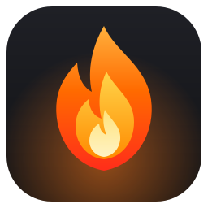
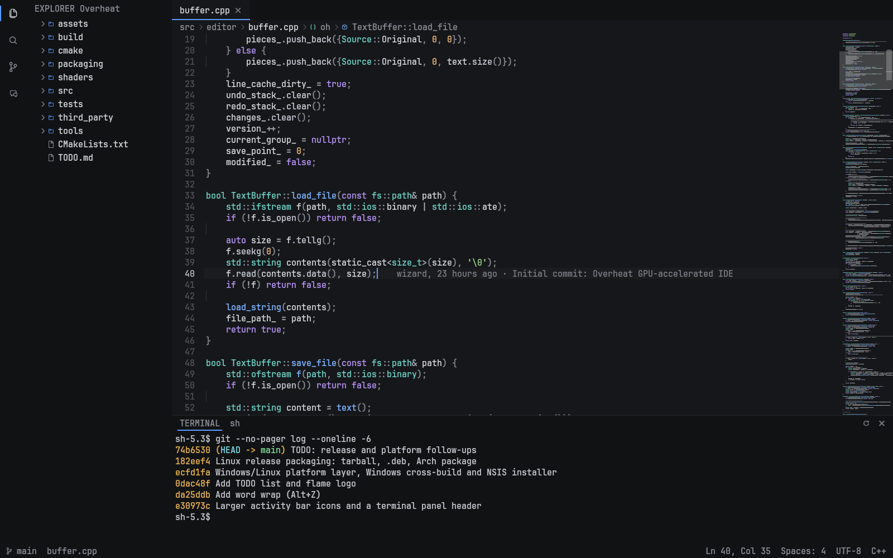
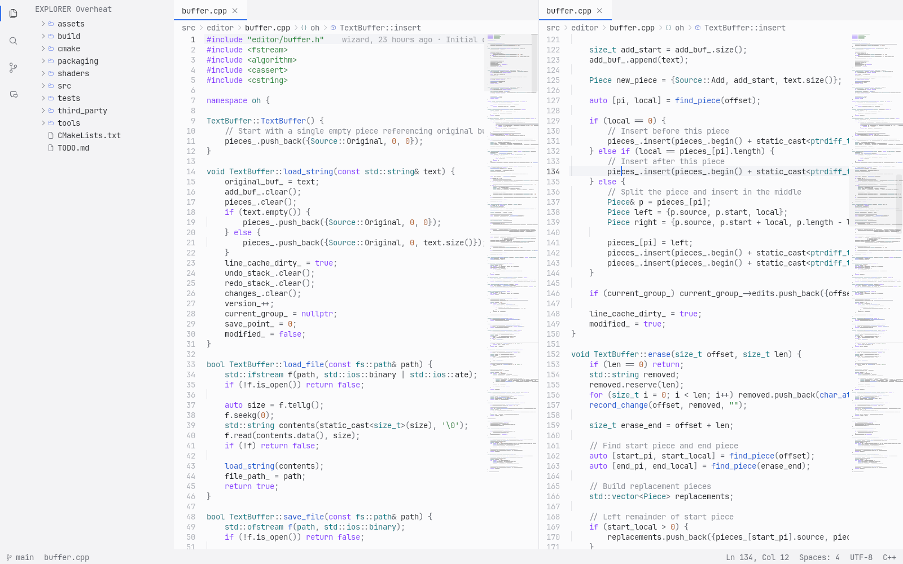
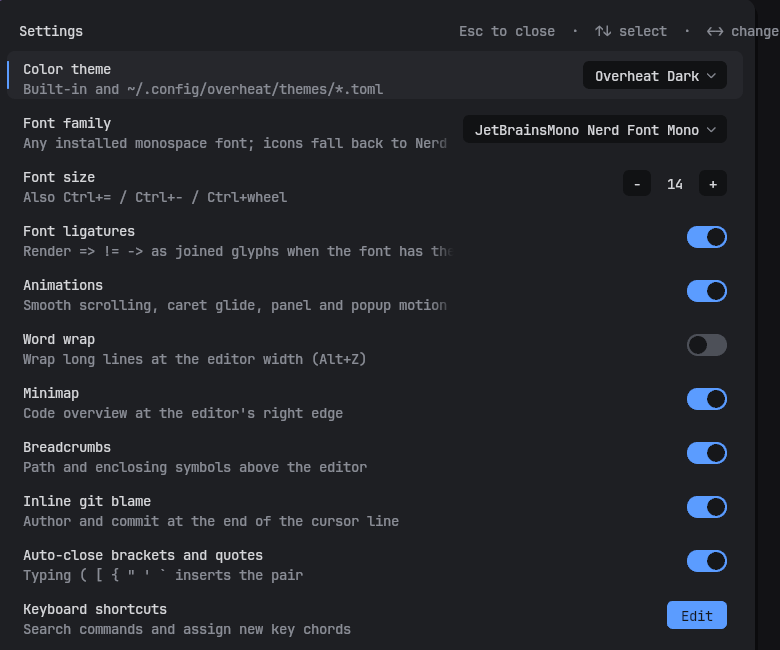
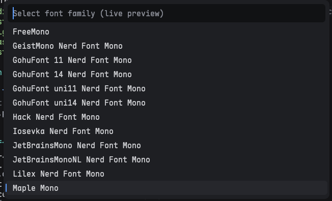

<div align="center">



# Overheat

**A code editor that runs hot and feels instant.**<br>
Sublime-class speed, VS Code-class features, drawn entirely on the GPU with Vulkan.

[](https://github.com/catalincd/Overheat/releases/latest)


[](LICENSE)

[Download](#-download) · [Features](#-features) · [Shortcuts](#%EF%B8%8F-keyboard-shortcuts) · [Build](#-building-from-source) · [Configure](#-configuration) · [Roadmap](TODO.md)

<br>



</div>

<br>

## 🔥 Why Overheat

- **Sub-millisecond frames.** The whole UI (text, panels, squiggles, rounded corners) is a single
  stream of instanced quads in a GPU buffer, drawn in one call per frame. Typical frames take
  **~0.2 ms**; first paint is **~30 ms**.
- **Idle means idle.** The event loop sleeps until something changes and paces animation to your
  display's refresh rate. No busy loops, no wasted watts.
- **Everything you reach for daily.** Language servers, Git, a real terminal, Remote-SSH,
  multi-cursor editing, split editors and an AI chat, all in one ~6 MB binary.

<table>
<tr>
<td width="50%"></td>
<td width="50%"></td>
</tr>
<tr>
<td align="center"><sub>Overheat Light · split editors · breadcrumbs</sub></td>
<td align="center"><sub>Settings page with live toggles</sub></td>
</tr>
</table>

## ✨ Features

<table>
<tr>
<td valign="top" width="33%">

### ✍️ Editing
- Multi-cursor: <kbd>Ctrl</kbd>+<kbd>D</kbd>, <kbd>Alt</kbd>+click, <kbd>Ctrl</kbd>+<kbd>Alt</kbd>+<kbd>↑</kbd>/<kbd>↓</kbd>
- 4coder-style <kbd>Ctrl</kbd>/<kbd>Alt</kbd>+arrow motion (words, camelCase parts, blank lines)
- Syntax-aware selection: expand / shrink to the enclosing tree-sitter node, hop between siblings
- Auto-closing brackets and quotes
- Bracket matching, indent guides
- Word wrap (<kbd>Alt</kbd>+<kbd>Z</kbd>)
- Move, duplicate and delete lines, toggle comments
- Find and replace, find in files
- Piece-table buffer with fast undo; opens 10+ MB files

</td>
<td valign="top" width="33%">

### 🧠 Code intelligence
- tree-sitter highlighting (C, C++, Rust)
- Language Server Protocol: diagnostics, completion, go to definition
- Breadcrumbs with the enclosing class and function
- Minimap with a viewport you can drag
- Squiggly underlines drawn by the shader

</td>
<td valign="top" width="33%">

### 🌿 Git
- Gutter markers for added, changed and deleted lines
- Source Control panel: stage, unstage, commit
- Branches with ahead/behind counts, checkout and create
- Inline blame on the cursor line
- Explorer colours from `git status`

</td>
</tr>
<tr>
<td valign="top">

### 🖥️ Workbench
- Integrated terminal (PTY on Linux, ConPTY on Windows)
- Split editors (<kbd>Ctrl</kbd>+<kbd>\\</kbd>), draggable tabs
- <kbd>Ctrl</kbd>+<kbd>Tab</kbd> through recent files
- Quick Open and Command Palette
- Panels you can resize, and your session restored on start
- Workspaces: named sets of local or Remote-SSH folders with their tabs, splits and
  panels. Never opened on their own; switch with <kbd>Ctrl</kbd>+<kbd>R</kbd>
- Open files reload when they change on disk

</td>
<td valign="top">

### 🌐 Remote-SSH
- Works like VS Code's Remote-SSH: pick a host from `~/.ssh/config`
- Host keys checked against `known_hosts`
- Logs in with ssh-agent, key files or a password
- Browse, edit and save over SFTP (saves are atomic)
- Remote terminal and remote search
- Remote monitor, like MobaXterm: live CPU, RAM, disk, network, load and uptime
  above the status bar; click it for per-core CPU, memory, filesystems and top processes

</td>
<td valign="top">

### 🎨 Look and feel
- Overheat Dark and Light themes, plus your own TOML themes
- Overheat's own file-type icons in the explorer, tabs, Quick Open and breadcrumbs (or minimal ones, or none)
- Ten bundled coding fonts (Fira Code, Cascadia Code, Iosevka, Maple Mono, Monaspace, ...) or any installed monospace font, with ligatures
- Text zoom with <kbd>Ctrl</kbd>+<kbd>+</kbd>/<kbd>-</kbd>/wheel
- Quick, subtle animations (or none): Neovide-style cursor smear that flies between splits and into
  the terminal, spring-based smooth scrolling, optional cursor particles (railgun, pixiedust, ripple, ...)
- Settings page and keyboard-shortcut editor
- Draft AI chat (any OpenAI-compatible endpoint)

</td>
</tr>
</table>

<div align="center">

<br><sub>Pick any installed monospace font; the editor previews it live</sub>
</div>

## 📦 Download

Grab the latest build from **[Releases](https://github.com/catalincd/Overheat/releases/latest)**.

| Platform | Package | Install |
|---|---|---|
| **Windows 10/11** | `Overheat-<ver>-win64-setup.exe` | Run the installer. It can add Start menu and desktop shortcuts, "Open with Overheat" in Explorer, and PATH |
| | `Overheat-<ver>-win64-portable.zip` | Unzip anywhere and run `overheat.exe` |
| **Linux (any distro)** | `Overheat-<ver>-x86_64.AppImage` | `chmod +x Overheat-*.AppImage && ./Overheat-*.AppImage` |
| | `overheat-<ver>-linux-x86_64.tar.gz` | Extract, then `./install.sh` (to `~/.local`) or `sudo ./install.sh` (to `/usr/local`) |
| **Debian / Ubuntu** | `overheat_<ver>_amd64.deb` | `sudo apt install ./overheat_*_amd64.deb` |
| **Arch Linux** | `overheat-<ver>-1-x86_64.pkg.tar.zst` | `sudo pacman -U overheat-*.pkg.tar.zst` |

> [!NOTE]
> **Requirements:** a GPU with a Vulkan 1.2 driver, x86-64-v2 CPU (2009+).
> The prebuilt Linux AppImage, tarball and .deb are built on Ubuntu 24.04 and need
> **glibc 2.38 or newer** (Ubuntu 24.04+, Debian 13+, Fedora 39+, any rolling distro). For
> older systems, see [Docker builds](docs/BUILDING.md#docker--podman).

## ⌨️ Keyboard shortcuts

<details>
<summary><b>Show all shortcuts</b> (every binding can be changed in the shortcut editor)</summary>

<br>

| Files & navigation | | Editing | |
|---|---|---|---|
| Quick Open | <kbd>Ctrl</kbd>+<kbd>P</kbd> | Add next match to selection | <kbd>Ctrl</kbd>+<kbd>D</kbd> |
| Open workspace (recent) | <kbd>Ctrl</kbd>+<kbd>R</kbd> | | |
| Command Palette | <kbd>Ctrl</kbd>+<kbd>Shift</kbd>+<kbd>P</kbd> | Add cursor above / below | <kbd>Ctrl</kbd>+<kbd>Alt</kbd>+<kbd>↑</kbd> / <kbd>↓</kbd> |
| Switch editor (recent) | <kbd>Ctrl</kbd>+<kbd>Tab</kbd> | Move line up / down | <kbd>Alt</kbd>+<kbd>↑</kbd> / <kbd>↓</kbd> |
| Next / previous tab | <kbd>Ctrl</kbd>+<kbd>PgDn</kbd> / <kbd>PgUp</kbd> | Duplicate line | <kbd>Ctrl</kbd>+<kbd>Shift</kbd>+<kbd>D</kbd> |
| Go to line | <kbd>Ctrl</kbd>+<kbd>G</kbd> | Delete line | <kbd>Ctrl</kbd>+<kbd>Shift</kbd>+<kbd>K</kbd> |
| Go to definition | <kbd>F12</kbd> | Toggle comment | <kbd>Ctrl</kbd>+<kbd>/</kbd> |
| Find / Replace | <kbd>Ctrl</kbd>+<kbd>F</kbd> / <kbd>Ctrl</kbd>+<kbd>H</kbd> | Select line | <kbd>Ctrl</kbd>+<kbd>L</kbd> |
| Find in files | <kbd>Ctrl</kbd>+<kbd>Shift</kbd>+<kbd>F</kbd> | Trigger suggestions | <kbd>Ctrl</kbd>+<kbd>Space</kbd> |
| Save / Save As | <kbd>Ctrl</kbd>+<kbd>S</kbd> / <kbd>Ctrl</kbd>+<kbd>Shift</kbd>+<kbd>S</kbd> | Undo / Redo | <kbd>Ctrl</kbd>+<kbd>Z</kbd> / <kbd>Ctrl</kbd>+<kbd>Shift</kbd>+<kbd>Z</kbd> |

| View | | | |
|---|---|---|---|
| Toggle terminal | <kbd>Ctrl</kbd>+<kbd>`</kbd> | Split editor | <kbd>Ctrl</kbd>+<kbd>\\</kbd> |
| Toggle sidebar | <kbd>Ctrl</kbd>+<kbd>B</kbd> | Focus left / right group | <kbd>Ctrl</kbd>+<kbd>1</kbd> / <kbd>2</kbd> |
| Explorer | <kbd>Ctrl</kbd>+<kbd>Shift</kbd>+<kbd>E</kbd> | Word wrap | <kbd>Alt</kbd>+<kbd>Z</kbd> |
| Source Control | <kbd>Ctrl</kbd>+<kbd>Shift</kbd>+<kbd>G</kbd> | Zoom in / out / reset | <kbd>Ctrl</kbd>+<kbd>+</kbd> / <kbd>-</kbd> / <kbd>0</kbd> |
| AI chat | <kbd>Ctrl</kbd>+<kbd>Alt</kbd>+<kbd>I</kbd> | Color theme | <kbd>Ctrl</kbd>+<kbd>K</kbd> <kbd>Ctrl</kbd>+<kbd>T</kbd> |
| Settings | <kbd>Ctrl</kbd>+<kbd>,</kbd> | Fullscreen | <kbd>F11</kbd> |

Cursor motion follows the **keymap preset** (`keymap` in `settings.toml`, or *Keymap* in Settings).
Add <kbd>Shift</kbd> to any motion to extend the selection; every cursor moves on its own.

| Cursor & selection | `"overheat"` (default, 4coder) | `"vscode"` |
|---|---|---|
| Word left / right | <kbd>Ctrl</kbd>+<kbd>←</kbd> / <kbd>→</kbd> (letters, digits, `_`; whitespace-separated in plain text) | <kbd>Ctrl</kbd>+<kbd>←</kbd> / <kbd>→</kbd> |
| camelCase / snake_case part | <kbd>Alt</kbd>+<kbd>←</kbd> / <kbd>→</kbd> | |
| Whole token (`foo.bar()`) | <kbd>Ctrl</kbd>+<kbd>Alt</kbd>+<kbd>←</kbd> / <kbd>→</kbd> | |
| Previous / next blank line | <kbd>Ctrl</kbd>+<kbd>↑</kbd> / <kbd>↓</kbd> | |
| Move line up / down | <kbd>Alt</kbd>+<kbd>↑</kbd> / <kbd>↓</kbd> | <kbd>Alt</kbd>+<kbd>↑</kbd> / <kbd>↓</kbd> |
| Add cursor above / below | <kbd>Ctrl</kbd>+<kbd>Alt</kbd>+<kbd>↑</kbd> / <kbd>↓</kbd> | <kbd>Ctrl</kbd>+<kbd>Alt</kbd>+<kbd>↑</kbd> / <kbd>↓</kbd> |
| Expand / shrink selection (syntax) | <kbd>Alt</kbd>+<kbd>Shift</kbd>+<kbd>↑</kbd> / <kbd>↓</kbd> | <kbd>Shift</kbd>+<kbd>Alt</kbd>+<kbd>→</kbd> / <kbd>←</kbd> |
| Select next / previous sibling node | <kbd>Alt</kbd>+<kbd>N</kbd> / <kbd>P</kbd> | <kbd>Alt</kbd>+<kbd>N</kbd> / <kbd>P</kbd> |

</details>

## 🛠 Building from source

Quick start on Arch Linux:

```bash
sudo pacman -S --needed base-devel cmake ninja shaderc glm vulkan-headers vulkan-icd-loader \
                        sdl3 freetype2 harfbuzz fontconfig libgit2 libssh2
git clone https://github.com/catalincd/Overheat && cd Overheat
cmake -S . -B build -G Ninja -DCMAKE_BUILD_TYPE=Release
cmake --build build
./build/overheat .
```

tree-sitter and its grammars are vendored, and shaders are compiled and embedded at build time,
so the binary has no runtime data files.

| Goal | Command | Output in `dist/` |
|---|---|---|
| Windows installer + portable zip (cross-compiled on Linux) | `packaging/windows/build.sh` | `*-win64-setup.exe`, `*-win64-portable.zip` |
| Self-contained Linux packages | `packaging/linux/build.sh` | `.AppImage`, `.tar.gz`, `.deb` |
| Arch package | `packaging/arch/build.sh` | `.pkg.tar.zst` |

### 🐳 With Docker or Podman

No toolchain on the host? Build every package in a container:

```bash
docker/build.sh linux     # Ubuntu 24.04 image → AppImage, .tar.gz, .deb (glibc ≥ 2.38)
docker/build.sh windows   # Arch + MinGW-w64 + Wine → setup.exe, portable zip
docker/build.sh arch      # Arch → .pkg.tar.zst
docker/build.sh all       # all of the above
docker/build.sh shell     # a shell in the build environment
```

See **[docs/BUILDING.md](docs/BUILDING.md)** for other distros, the Windows toolchain and
the container details.

## ⚙️ Configuration

Settings live in `~/.config/overheat/` (Linux) or `%APPDATA%\Overheat\` (Windows). The settings page
(<kbd>Ctrl</kbd>+<kbd>,</kbd>) edits them for you; the files are plain text:

```toml
# settings.toml
theme = "Overheat Dark"
font_family = "JetBrainsMono Nerd Font Mono"
font_size = 15
ligatures = true
word_wrap = false
minimap = true
animations = true                    # master switch for everything below
cursor_animation = "smear"           # smear | glide | none
cursor_animation_ms = 150            # jump settle time; cursor_short_animation_ms = 40 for typing
cursor_trail = 0.8                   # 0 = rigid glide .. 1 = longest smear
cursor_vfx = "none"                  # railgun | torpedo | pixiedust | sonicboom | ripple | wireframe
scroll_animation_ms = 250            # smooth-scroll spring; 0 = instant
wobbly = false                       # elastic pop for the palette and settings page
keymap = "overheat"                  # or "vscode": Ctrl+arrows move by VS Code words
animations = true
file_icons = "overheat"              # "overheat" | "minimal" | "none"
opacity = 1.0                        # 0.5-1.0: translucent background, opaque text
terminal_shell = "pwsh -NoLogo"      # any shell; default: $SHELL / PowerShell
remote_monitor = true                # host stats strip while on Remote-SSH
local_monitor = false                # the same strip for this computer
```

<details>
<summary><b>Custom themes</b></summary>

<br>

Drop a `.toml` file into `themes/`. Set `base` to inherit everything you don't override:

```toml
name = "Ember"
base = "Overheat Dark"
dark = true

[ui]
accent = "#ff6a00"

[editor]
background = "#141210"
current_line = "#1f1a16"

[syntax]
keyword = "#ff8a3d"
string = "#ffd27a"
comment = "#7d6e60"
```

Pick it with <kbd>Ctrl</kbd>+<kbd>K</kbd> <kbd>Ctrl</kbd>+<kbd>T</kbd>. Colours are `#rrggbb` or `#rrggbbaa`; theme files
reload when you save them.

</details>

<details>
<summary><b>Workspaces</b></summary>

<br>

A workspace is a named set of root folders (local paths or `ssh://host/path`) plus the
open tabs with cursor and scroll positions, the split layout, the terminal and sidebar
state, and optional settings overrides. Each one is a file in `workspaces/<name>.toml`:

```toml
name = "overheat"
folders = ["/home/me/Overheat", "ssh://devbox/srv/api"]   # first = primary

[settings]          # applied while the workspace is open, never written to settings.toml
theme = "Overheat Light"
word_wrap = true    # also: font_family, font_size, minimap, breadcrumbs, ligatures, ...
```

- **Nothing opens by itself.** Startup and *File: Open Folder...* never load a workspace;
  when a folder belongs to one, the status bar and the welcome screen point it out.
- **Switcher** (<kbd>Ctrl</kbd>+<kbd>R</kbd>): recent first, fuzzy filter; inside a workspace
  <kbd>Ctrl</kbd>+<kbd>R</kbd> <kbd>Enter</kbd> jumps back to the previous one.
- **Autosave:** the session is saved when you switch away, close it or quit, but only for a
  workspace you opened or saved yourself.
- Commands: *Save Workspace As...*, *Add Folder to Workspace...* (multi-root explorer),
  *Close Workspace*, *Delete Workspace...*, *Edit Workspace File*.
- A project can ship a shared `.overheat-workspace` file (same format, folders relative to
  it); your personal tabs and layout for it stay in the config folder.

</details>

<details>
<summary><b>Key bindings, language servers, AI chat</b></summary>

<br>

- **Key bindings:** use the shortcut editor in Settings, or edit `keybindings.json`
  (`{"Ctrl+Alt+T": "toggle_terminal"}`).
- **Language servers:** C and C++ use `clangd`, Rust uses `rust-analyzer`, from your `PATH`. Give clangd a
  `compile_commands.json` (`-DCMAKE_EXPORT_COMPILE_COMMANDS=ON`) for accurate results.
- **AI chat (draft):** choose a backend with *AI: Select Backend*. Any OpenAI-compatible
  `/v1/chat/completions` endpoint works. API keys are read from the `OVERHEAT_LLM_API_KEY`
  environment variable and are never written to disk.
- **Remote-SSH:** *Remote-SSH: Connect to Host...* reads `~/.ssh/config` (override with
  `OVERHEAT_SSH_CONFIG`).
- **Remote monitor:** while connected, a strip above the status bar shows the host's CPU,
  RAM, disk, network, load and uptime, sampled every 2 s over a second SSH connection
  (same login, host key pinned) by one small `sh` script reading `/proc`, `df` and `ps`.
  Click it, or run *Remote-SSH: Show System Monitor Details*, for the detail card. macOS
  and BSD hosts show what they can (load, uptime, memory total, disks). Toggle it in
  Settings or with *Remote-SSH: Toggle Remote Monitor*; *View: Toggle Local System
  Monitor* shows the same strip for this computer.

</details>

## 🧩 Under the hood

```
SDL3 window ─▶ App (event loop, layout, commands)
                 ├─ EditorView ─▶ Editor ─▶ TextBuffer (piece table, undo, change log)
                 │                   └──▶ Syntax (tree-sitter, incremental + async parse)
                 ├─ Terminal, FileTree, SCM, Search, Chat, Palette, Settings …
                 └─ Renderer2D ─▶ one SSBO of instanced quads ─▶ Vulkan (1 draw / frame)
                                   ▲ FontAtlas: FreeType + HarfBuzz, lazy glyph cache
platform/ (POSIX · Win32)   lsp/ (JSON-RPC)   git/ (libgit2)   ssh/ (libssh2 + SFTP)
```

- **Renderer:** every element is a `Quad` (rect, clip, colour, kind) written into a host-visible
  storage buffer. The vertex shader expands instances, and the fragment shader handles clipping,
  fades, rounded corners, subpixel glyph sampling and squiggles. Colours are blended in linear
  space on an sRGB swapchain.
- **Text:** glyphs are rasterised lazily into a 2048² atlas. HarfBuzz runs are cached per line, so
  ligatures cost nothing after the first frame.
- **File icons:** a small icon font generated from code (`assets/icons/`) and embedded in the
  binary. Marks go through the glyph path, so they follow zoom and stay sharp; the tinted tile
  behind each one is a pixel-snapped quad, coloured per file type for dark or light themes.
- **Editor core:** a piece table with positional undo groups and a change log that feeds
  tree-sitter's incremental `ts_tree_edit`. A fuzz test with ASan/UBSan guards it.
- **Platform layer:** `src/platform/` wraps processes, pseudo-terminals (forkpty / ConPTY),
  paths and shared libraries, so the rest of the code is OS-agnostic.

```
src/
├── app.cpp            workbench: layout, commands, sessions, settings
├── renderer/          Vulkan context, quad renderer, font atlas
├── editor/            buffer, cursors, editor ops, tree-sitter syntax
├── ui/                editor view, terminal, panels, palette, settings
├── platform/          POSIX + Win32 implementations
├── lsp/ git/ ssh/     language servers, libgit2, libssh2
shaders/               quad.vert / quad.frag (GLSL → SPIR-V, embedded)
assets/icons/          file-icon font and its generator (embedded at build time)
packaging/             windows/ (NSIS, MinGW toolchain), linux/, arch/
third_party/           tree-sitter core + C/C++/Rust grammars (MIT)
```

## 🗺 Roadmap

Next up: hover tooltips, rename and format, symbol search, a Problems panel, Git and language
servers over Remote-SSH, more grammars, and tool use in the AI chat. See
**[TODO.md](TODO.md)** for the full list and known limitations.

## 📄 License

Overheat is licensed under the **[Apache License 2.0](LICENSE)**. Vendored tree-sitter code is MIT
(`third_party/`), and the bundled fonts are SIL OFL 1.1 (Hack: MIT); see
[assets/fonts/README.md](assets/fonts/README.md).

## 🙏 Acknowledgements

Built on [SDL3](https://libsdl.org), [Vulkan](https://www.vulkan.org),
[FreeType](https://freetype.org), [HarfBuzz](https://harfbuzz.github.io),
[tree-sitter](https://tree-sitter.github.io), [libgit2](https://libgit2.org) and
[libssh2](https://libssh2.org). Ships with
[JetBrains Mono Nerd Font](https://www.nerdfonts.com), Fira Code, Cascadia Code, Iosevka,
Maple Mono, Source Code Pro, Hack, IBM Plex Mono, Geist Mono and Monaspace.

<div align="center">
<br>
<br>
<sub>Made with too many frames per second.</sub>
</div>
