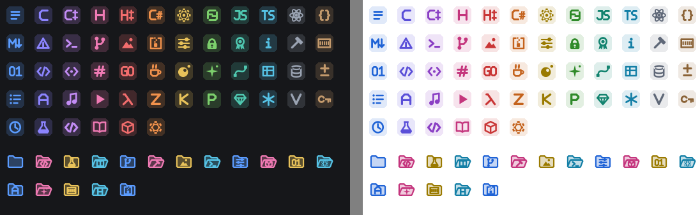

# Overheat file icons



Overheat's own file-type icons, used in the explorer, tabs, Quick Open and breadcrumbs
(setting `file_icons = "overheat" | "minimal" | "none"`, or *Preferences: File Icon Theme*).

## Style

- **Files:** a rounded tile tinted with the file type's hue, and a monoline mark in the same
  hue on top. Marks sit on a 16×16 grid, use round caps and joins and about 1.6 units of
  stroke, and use chamfered corners where letters need corners (`C`, `TS`, `JS`, `GO`...).
- **Folders:** a tinted folder silhouette, a full-colour outline and, for well-known
  folders (`src`, `test`, `docs`, `.git`, `build`, `assets`...), a small badge in the body.
  Each has a closed and an open shape. Plain folders use the theme's accent colour.
- **Colours:** twelve hues (blue, indigo, purple, pink, red, orange, yellow, green, teal,
  cyan, gray, brown), each with a dark-theme and a light-theme value (`kHues` in
  `src/ui/file_icons.cpp`). The tint is the same hue at low alpha, so it works on any
  background and in selections.

## How it is built and drawn

`build_icons.py` holds the geometry as Python code: strokes, arcs, circles and polygons
on the 16×16 grid. It writes:

| File | Use |
|---|---|
| `OverheatIcons.ttf` | the icon font: one glyph per mark, folder layer and badge (Private Use Area, U+E000 up) |
| `../../src/ui/file_icon_glyphs.h` | the codepoint of every glyph, by name |
| `preview.png` | the sheet above (only when Pillow is installed) |

All three are committed. The C++ build does not run Python: CMake embeds the font into the
binary (`cmake/embed_file.cmake` → `build/generated/overheat_icons_ttf.h`), so Linux and the
MinGW Windows build need nothing new. `FontAtlas::icon_glyph()` loads the font as a separate
FreeType face (it never takes part in text fallback) and rasterises a glyph unhinted at the
icon's pixel size. Marks therefore go through the normal glyph atlas and stay sharp at any
font size, zoom or DPI. The tile behind a file mark is a quad snapped to whole pixels.

Strokes are built as overlapping outlines. Each glyph has the TrueType `OVERLAP_SIMPLE` flag,
so FreeType renders the overlaps cleanly.

## Changing icons

```sh
pip install fonttools pillow        # Pillow only for preview.png
python3 assets/icons/build_icons.py
cmake --build build
```

- **New file type with an existing mark:** add a row to `src/ui/file_icon_map.cpp`. Use an
  exact name, an extension (compound ones like `d.ts` work) or a name prefix. Choose a hue.
  `tests/file_icon_test.cpp` checks the lookup.
- **New mark:** add a function decorated with `@mark("name")` in `build_icons.py`, rebuild,
  and use `icon_glyph::name` in the table.
- **New special folder badge:** add the mark's name to `FOLDERS` in `build_icons.py`. That
  makes `badge_<name>` and `badge_open_<name>`. Then add the folder names to `kFolders`.

Glyphs are numbered in the order they are defined, so adding marks renumbers the ones after
them. That is fine because the header is regenerated together with the font.
